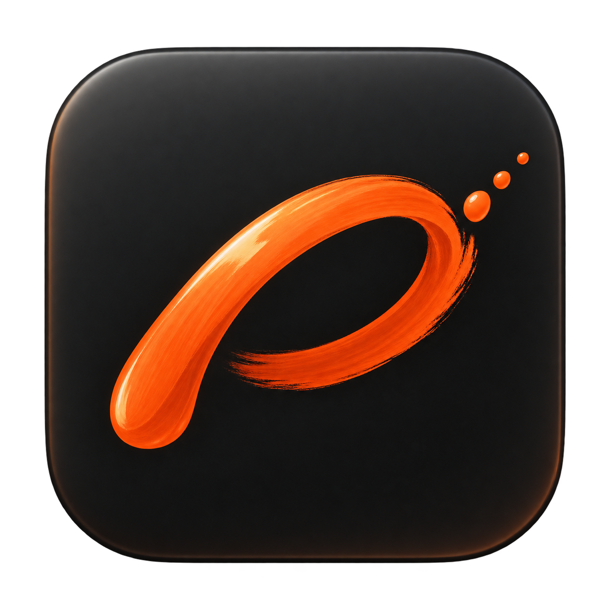
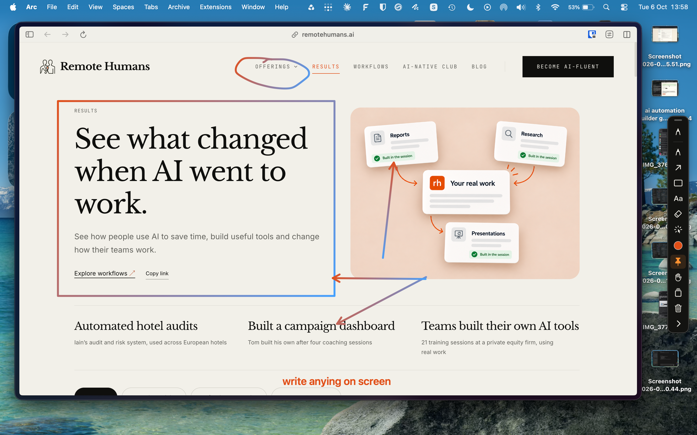

<p align="center"></p>

# ScreenInc

Make your screen easier to follow.

You’re sharing a screen and explaining something. A number in a spreadsheet. A button someone needs to find. The connection between two steps in a workflow. Your pointer is moving, but the people watching still have to work out what you mean.

ScreenInc lets you draw directly over the app you’re using. Circle the detail, draw an arrow, or spotlight the area as you explain it. Let the ink fade when the moment has passed, or keep it visible while you build the explanation.

**[Download the latest preview](https://github.com/remotehumans/ScreenInc/releases/latest)** · **[Watch the 75-second demo](https://github.com/remotehumans/ScreenInc/releases/download/v0.4.1/ScreenInc-Demo.mp4)** · **[Installation help](docs/INSTALL.md)**

[](https://github.com/remotehumans/ScreenInc/releases/download/v0.4.1/ScreenInc-Demo.mp4)

*Circle a navigation item, frame the section you’re discussing, and connect ideas with arrows, directly on the page.*

## Where it helps

### Walk someone through a process

You’re teaching a colleague how to use a piece of software. Circle the next button, add a numbered marker, then return control to the app and carry out the step. Let each annotation fade so the next step starts with a clear screen.

### Explain a live demo

You’re showing a website, product, or workflow. Frame the result you want people to notice, draw an arrow between related parts, and use the spotlight to focus attention on a small detail. Keep the actual product on screen as you explain it.

### Record a tutorial

You’re recording a walkthrough and want viewers to know where to look. Add emphasis as you speak: a quick underline, a circle, a label. Capture the whole display with your recording app so the annotations appear in the video. ScreenInc provides the annotations; your recording app captures them.

### Give feedback in a call

You’re reviewing a page, slide, or design together. Mark the area you mean and add a short note while the conversation continues. Share your entire display to include the overlay; sharing only one app window can leave the annotations out.

### Build an explanation in a training session

Switch ink to **Keep** and sketch a connection or sequence over your material. Use the whiteboard when you need a clear space to draw. Save the drawing as a snapshot so you can bring it back later in the session.

These are suggested workflows for the current tools, not claims of testing with every meeting or recording app. Check your shared or recorded view before a session.

## Why ScreenInc exists

ScreenInc began with a practical question: could we build our own Mac tool for drawing over the screen during demos and training? Research into ScreenBrush helped shape the starting point: ink that fades after you use it, and controls that leave room for the content.

The result is a native Mac app with a narrow edge toolbar. Keep the pencil and shapes close by, hide the toolbar when you need the space, and open the larger controls only when you need them. It’s free and open source so others can use it, inspect it, and help improve it.

## What’s in the preview

- **Draw and emphasise:** pen, highlighter, shapes, arrows, text, gradients, fading or persistent ink.
- **Edit your explanation:** select, move, duplicate, recolour, resize, erase, and undo.
- **Guide attention:** spotlight, magnification, cursor highlights, numbered markers, and a countdown.
- **Return to an idea:** save and restore drawing snapshots; export annotations as PNG, PDF, or flattened PSD.

Exports contain the drawings, not the apps underneath. See the [feature verification matrix](docs/feature-verification.md) for device and permission checks that remain outstanding.

**Camera gestures are WIP.** They are included as an experiment, but real-world tracking, tool selection, and drawing are not reliable enough to recommend for presentations or training. Use the mouse or trackpad for the workflows above. Passing automated tests does not establish usable hand control.

Voice-driven, screen-aware highlighting is an idea for later. It is not available in this release; you control annotations and spotlighting yourself.

## Install

Requires macOS 14 or newer. The universal download includes Apple Silicon and Intel builds; Intel has not yet been tested on hardware.

1. Download the `.dmg` from Releases.
2. Open it and drag **ScreenInc** to **Applications**.
3. Open ScreenInc and follow the [first-launch instructions](docs/INSTALL.md).

Free under the MIT licence. This is an early preview. The published 0.4.1 download is ad-hoc signed and is not Apple-notarized. See the release notes for the signing status of the file you download.

No account or API key is needed. Experimental camera processing stays on your Mac. The optional phone remote uses your local network.

## Start

Open ScreenInc from Applications. Click the pencil on the 44-point edge palette, or use **Control–Option–D**. **Escape** returns control to the app underneath. **Tab** hides or shows the palette. Drag its handle to move it.

Click the colour circle for quick settings. Click the stacked-squares button, or press **Command–Comma**, for **ScreenInc Studio**. Studio contains Drawing, Snapshots, Present, Keys, Remote, and Guide tabs. It closes when you choose a drawing tool.

Each new stroke holds for the selected delay, then fades over one second. **F** switches new ink between fade and keep; existing strokes retain their original timing. Studio supports delays up to 120 seconds. Whiteboard hides during click-through and returns when drawing resumes.

## Camera gestures — WIP

**Experimental and currently unreliable.** User testing has found that camera gestures do not work reliably enough for normal use. Tracking, pinch detection, and tool selection need further work. The instructions below describe the intended interaction for contributors and testers, not a dependable hands-free workflow.

<details>
<summary>Try the experimental controls</summary>

Click the **hand button** on the palette, or open **Studio → Present → Camera controls**. Choose **Start camera**, allow macOS Camera access, and check that the preview shows your whole hand and the status reads **Ready · pinch to draw**. Choose **2. Start drawing** to close setup and draw on your screen. Camera control stays off after relaunch.

- Point with your index finger to move ScreenInc’s pointer.
- Pinch thumb and index finger to draw. Release to end the stroke.
- Hold an open palm for 0.7 seconds to show the gesture menu. Point at a tile, then pinch to select it. Release between choices.
- Choose tools, colours, gradient settings, stroke width, fade/keep, undo/redo, snapshot, selection actions, whiteboard, or another screen from the menu.
- **Actions → Pause** pauses drawing; an open palm still opens the menu so you can resume. **Stop camera** ends tracking. Clear ink requires two separate selections.
- If your hand disappears or tracking jumps, the current stroke ends at its last safe position. Separate thumb and finger before beginning again.

Keep one hand visible and face the palm towards the camera. Use **Mirror hand movement**, **Smaller hand travel**, and **Smoothing** to adjust control. Increase **Pinch sensitivity** if your hand is tracked but touching thumb and index finger does not show **Pinch detected**. The settings window suppresses drawing while you calibrate. The larger menu is temporary; the ordinary palette remains 44 points wide.

Frames are processed locally with Apple Vision, never recorded or uploaded. Gesture control drives the canvas directly and requires no Accessibility or Screen Recording permission. Mouse clicks continue to reach the underlying app during gesture mode. Text entry and image import still use ordinary controls. Earlier live hand detection was observed, but subsequent user feedback reports that gestures are not working reliably; see [gesture verification](docs/hand-gesture-verification.md).

</details>

## Drawing and editing

Pen, highlighter, arrows, lines, rectangles, ellipses, triangles, multiline text, numbered badges, laser, spotlight, selection, eraser, and image import are available. Hold Shift to constrain shapes. Text uses Return for a new line and **Command–Return** to finish; Escape cancels editing.

Choose **Select**, click an object, or drag a selection box. Shift adds objects. Drag selected objects to move them. Drag a bottom-right handle to resize. Studio provides duplicate, recolour, group, ungroup, front/back order, delete, and destination-screen controls. Objects can also move across displays during a drag. Delete removes a selected area of drawings.

The eraser cuts freehand strokes into editable pieces. Disable **Partial stroke eraser** for whole-object deletion. Shape/text/image erasing removes the object. Scroll to change eraser size. Each eraser gesture has one undo step.

Choose custom colours, two-colour gradients for strokes and shapes, opacity, shadows, and whiteboard colour. Each tool remembers its colour. Compatible tablet events change pen/marker width with pressure; the reverse stylus tip erases.

## Snapshots, recovery, and export

**Command–S** saves to the persistent visual library. Double-click a preview, or use Restore, to recover editable objects. **[** and **]** cycle snapshots. Rename snapshots in the library. Drag a preview into another app to export its PNG.

Settings, the active tool, and unexpired ink recover after restart. Data lives in `~/Library/Application Support/ScreenInc/`. Restored snapshots stay on screen. **Shift–Command–S** saves portable JSON; **Command–O** opens it. Earlier drawing files remain readable.

Studio exports PNG, PDF, or PSD for the display under the pointer. **Command–C** copies that display’s drawing. Whiteboard colour is included when enabled; otherwise the background is transparent. PDF preserves vector paths. PSD is flattened, with transparency and an embedded sRGB profile; editable objects remain in snapshots/JSON. Ink exports do not capture the underlying apps.

## Present

Enable cursor halo, click rings, numbered badges, countdown, and lower-third text in Present. Spotlight radius and magnification are adjustable. Select a rectangular spotlight region or copy a selected screen region. Magnification excludes ScreenInc’s own windows to avoid feedback.

Basic drawing needs no screen capture permission. Magnification and screen-region copying require macOS Screen Recording permission. Hold-Fn switching outside ScreenInc and remote slide-key control may require Accessibility permission. The app never silently grants these permissions.

Share your entire display in calls to include annotations; single-window sharing usually excludes overlay windows.

## iPhone / iPad remote

In Remote, choose **Start remote**. Connect both devices to the same trusted Wi-Fi, then scan the QR code or open the pairing address in Safari. Add to Home Screen if wanted. The remote is a browser companion, not an App Store app.

It controls snapshots, undo, clear, drawing mode and the timer. Its touch pad sends a stroke when the finger/stylus lifts, using the Mac’s current style. Slide arrows send left/right keys to the last external Mac app after Accessibility permission is enabled. The server accepts only its random session pairing URL. Stop remote invalidates the link; it stays off after relaunch.

## Default keys

| Action | Shortcut |
|---|---|
| Draw / click through | Control–Option–D |
| Studio | Command–Comma |
| Return control / hide palette | Escape / Tab |
| Pen / marker | B / H |
| Arrow / line | A / L |
| Rectangle / ellipse / triangle | R / O / G |
| Text / eraser / selection | T / E / V |
| Laser / spotlight / badge | X / S / N |
| Import image | I |
| Fade or keep / whiteboard | F / W |
| Colour palette | 1–7 |
| Undo / redo | Command–Z / Shift–Command–Z |
| Duplicate / group / ungroup | Command–D / Command–G / Shift–Command–G |
| Back / front | Command–[ / Command–] |
| Delete selected / clear all | Delete / Command–Delete |
| Save snapshot / cycle | Command–S / [ and ] |
| Repeat last drawing | ; |

Keys includes tool remapping, a global shortcut recorder, and two presets. Enable hold-Fn to temporarily invert drawing/click-through mode. Shortcut conflicts are reported in the status message.

## Build and verification

```sh
./script/build_and_run.sh
swift test --disable-sandbox
```

Build modes: `--build-only`, `--verify`, `--debug`, `--logs`, `--telemetry`. The script builds `dist/ScreenInc.app` and signs it locally. Open this folder as a Codex project to use its Run action.

The automated suite passes 42 tests, including 18 gesture tests. Installed-app checks include a browser-to-Mac gradient stroke, duplication, snapshots, recovery, local shortcuts, countdown, title, and the guide. Physical mouse dragging on the borderless overlay could not be automated. Tablet hardware, iPhone/iPad Safari, multiple displays/fullscreen, hold-Fn, global shortcut activation from another app, actual screen capture permission, and external slide control still need manual validation. See the [feature verification matrix](docs/feature-verification.md) for exact boundaries.

## Build a distributable

Install Xcode command line tools, then run:

```sh
swift test --disable-sandbox
./script/package_release.sh
```

The universal DMG and SHA-256 checksum appear in `dist/`. See [release instructions](docs/RELEASING.md) for Developer ID signing and notarization.

## Contribute

See [CONTRIBUTING.md](CONTRIBUTING.md). Report reproducible problems through [GitHub Issues](https://github.com/remotehumans/ScreenInc/issues), including your Mac model, macOS version, and steps. See [SECURITY.md](SECURITY.md) for private vulnerability reports.

ScreenInc was independently built by Remote Humans after researching ScreenBrush. It is not affiliated with ScreenBrush and includes none of its code or assets. Demo footage includes the original product for context. Website and third-party marks shown in the demo remain their owners’ property.
